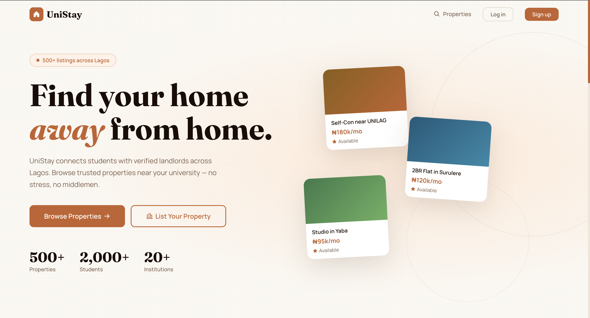
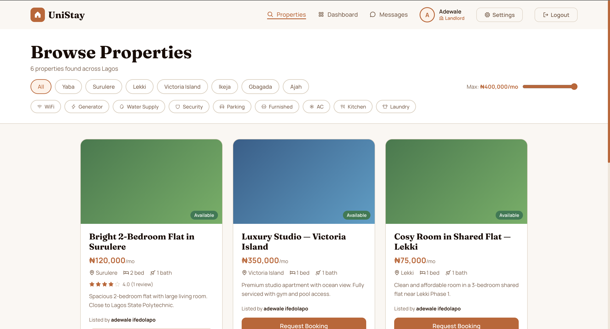
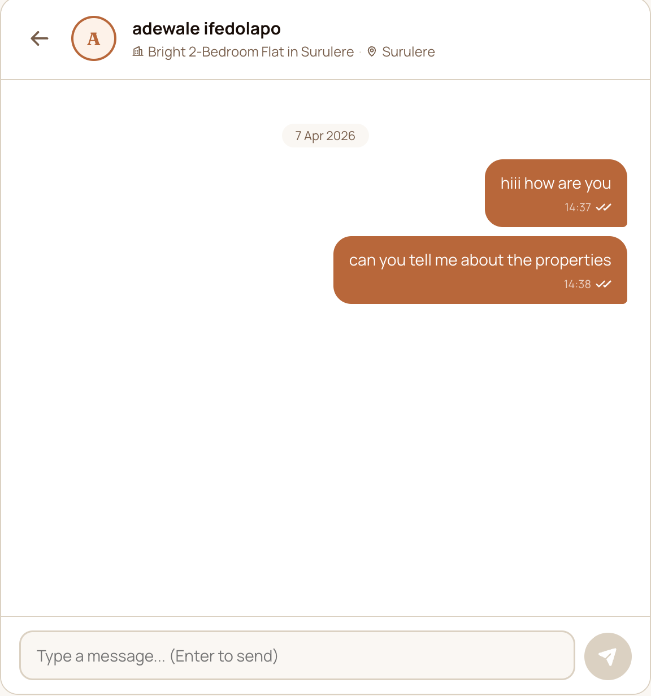

# Selected web development case studies

## Ifedolapo Adewale (Ifedolapo Egberongbe)

Software engineer based in Lagos, Nigeria. I work with React, JavaScript, Node.js, Express, REST APIs, Tailwind CSS and WordPress. I support startups, agencies and small businesses with frontend development, API integration, website improvements and maintenance.

[GitHub](https://github.com/Adewale201) · [LinkedIn — contact me](https://www.linkedin.com/in/egberongbe-ifedolapo/)

## 1. ROOTED — botanical landing page

**Project type:** Self-directed frontend project.

**The brief:** Create a coherent botanical brand experience with a multi-section landing page that works across screen sizes.

**My work:** Built the page with React and arranged the experience into Hero, Vision, Philosophy, Impact, Contact and Footer sections. Used Tailwind CSS and CSS for layout, visual styling and responsive behavior.

**Tools:** React, JavaScript, Vite, Tailwind CSS, HTML and CSS.

**Deliverable:** A source-available landing page implementation showing how I translate a visual concept into reusable frontend sections. This is a portfolio project; no client revenue or conversion improvement is claimed.

**Useful for:** Brand landing pages, startup launch pages and agency frontend implementation.

[Browse ROOTED source](https://github.com/Adewale201/Rooted) · [Review the page composition](https://github.com/Adewale201/Rooted/blob/main/src/App.jsx)

## 2. UniStay — student accommodation platform in development

**Project type:** Ongoing product project; not a fully launched business.

**The problem:** Nigerian students need a clearer way to discover suitable accommodation and assess available options.

**My work:** Building UniStay using React, Node.js and Express. My work includes backend development, REST API design and frontend collaboration. The portfolio previews below show the intended accommodation browsing, registration and messaging experience.

**Tools:** React, JavaScript, Node.js, Express and REST APIs.

**Deliverable and current status:** An ongoing platform implementation with interface previews. Product development continues; the screenshots do not establish a completed launch, user adoption or commercial results.

**Useful for:** Startup web products, listing platforms, frontend/backend integration and API development.

[Review the public portfolio project data](https://github.com/Adewale201/ifedolapo-portfolio/blob/main/src/data/projects.ts)

## 3. Personal portfolio — organizing development work

**Project type:** Personal website project.

**The brief:** Give prospective employers and clients a clear way to review my work, technical background and contact options.

**My work:** Built a component-based portfolio with project previews, experience information and contact sections. The repository includes reusable UI components, project data and visual previews rather than a folder of unexplained files.

**Tools:** React, TypeScript, Vite and Tailwind CSS.

**Deliverable:** A public website codebase with examples of reusable interface components and structured project presentation. No traffic or lead-generation figures are claimed.

**Useful for:** Portfolio websites, service websites, component-based frontend work and content organization.

[Browse portfolio source](https://github.com/Adewale201/ifedolapo-portfolio) · [Review project presentation](https://github.com/Adewale201/ifedolapo-portfolio/blob/main/src/sections/projects/Projects.tsx)

## Discuss a project

If you need a React interface, backend endpoints, API integration, website redesign or ongoing maintenance, [message me on LinkedIn](https://www.linkedin.com/in/egberongbe-ifedolapo/) with your current website or product, the problem you want solved and your preferred timeline. I can suggest a sensible first scope before agreeing on cost and delivery.
